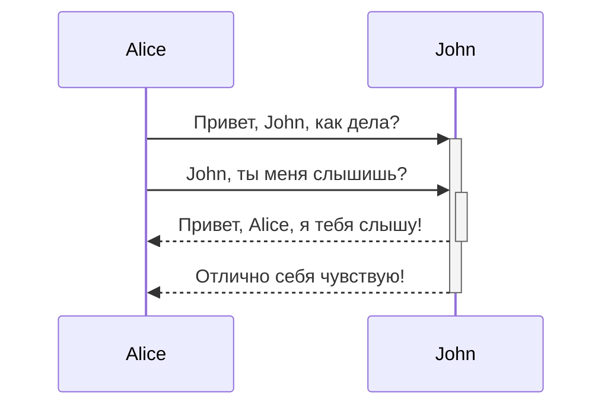
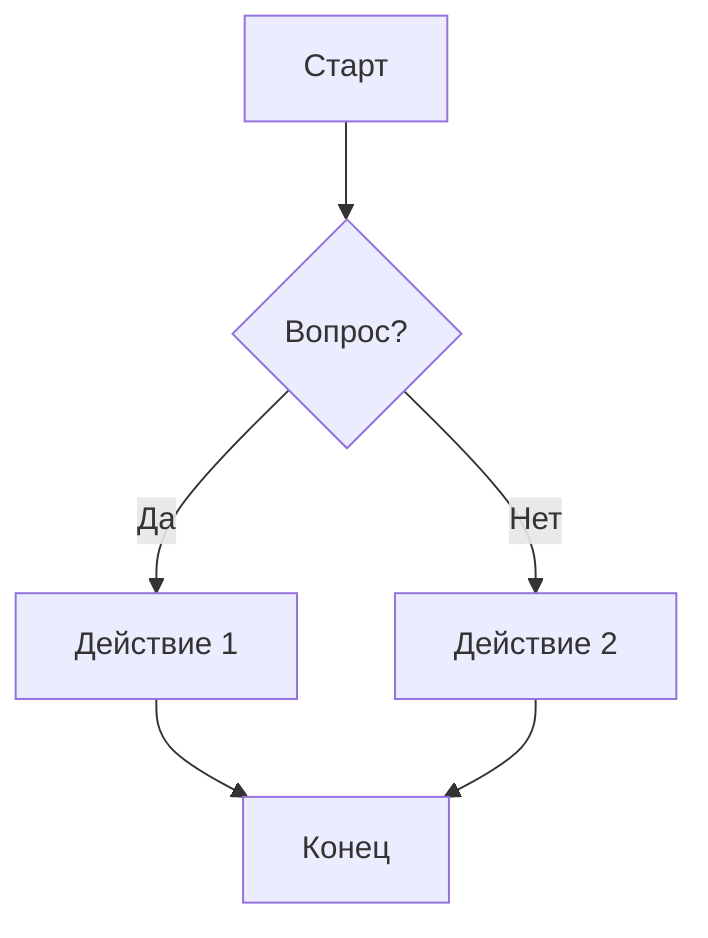
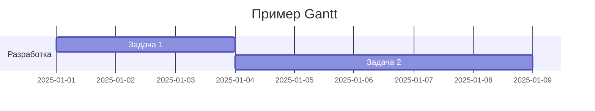

---
tags:
  - example
  - test
created: 2026-06-29T02:53:09
updated: 2026-07-01T12:54:39
title: Превью темы оформления
---
> [!info]
> Этот файл рекомендуется использовать для тестирования тем Obsidian
# Заголовок 1

Lorem ipsum dolor sit amet, consectetur adipiscing elit. Vestibulum scelerisque tincidunt lacus, vel dapibus lorem faucibus id. Nulla facilisi. Morbi tincidunt sapien nec erat consequat, ut cursus justo congue.

***Русский:***
Это пример текста с использованием различных стилей в Markdown. **Жирный текст** помогает выделить важные моменты, в то время как *курсив* используется для выделения менее значительных деталей или акцентов. ~~Зачеркнутый текст~~ может показать удаленные или неактуальные данные.

Выделение текста как ==хайлайт== помогает обратить внимание на ключевые фрагменты. ***Жирный курсив*** может использоваться для особо важного акцента. `Код` обычно выделяется с помощью моноширинного шрифта, что делает его легко различимым. Для добавления внешних ресурсов используем [ссылку](https://example.com) или ссылку как есть <https://example.com>. Хештеги, такие как #пример, часто используются для классификации или поиска контента. В математических текстах инлайн формула, например, $E = mc^2$, может быть использована для представления научных данных.

## Заголовок 2 - **жирный**, *курсив*, ***жирный курсив***

Lorem ipsum dolor sit amet, consectetur adipiscing elit. Vestibulum scelerisque tincidunt lacus, vel dapibus lorem faucibus id. Nulla facilisi. Morbi tincidunt sapien nec erat consequat, ut cursus justo congue.

### Заголовок 3

Lorem ipsum dolor sit amet, consectetur adipiscing elit. Vestibulum scelerisque tincidunt lacus, vel dapibus lorem faucibus id. Nulla facilisi. Morbi tincidunt sapien nec erat consequat, ut cursus justo congue.

#### Заголовок 4

Lorem ipsum dolor sit amet, consectetur adipiscing elit. Vestibulum scelerisque tincidunt lacus, vel dapibus lorem faucibus id. Nulla facilisi. Morbi tincidunt sapien nec erat consequat, ut cursus justo congue.

##### Заголовок 5

Lorem ipsum dolor sit amet, consectetur adipiscing elit. Vestibulum scelerisque tincidunt lacus, vel dapibus lorem faucibus id. Nulla facilisi. Morbi tincidunt sapien nec erat consequat, ut cursus justo congue.

###### Заголовок 6

***Жирный курсив как маленький заголовок***
Lorem ipsum dolor sit amet, consectetur adipiscing elit. Vestibulum scelerisque tincidunt lacus, vel dapibus lorem faucibus id. Nulla facilisi. Morbi tincidunt sapien nec erat consequat, ut cursus justo congue.

**Жирный как маленький заголовок**
Lorem ipsum dolor sit amet, consectetur adipiscing elit. Vestibulum scelerisque tincidunt lacus, vel dapibus lorem faucibus id. Nulla facilisi. Morbi tincidunt sapien nec erat consequat, ut cursus justo congue.

# Базовый синтаксис форматирования

Aliquam commodo, erat id rutrum interdum, dui ligula blandit massa, quis scelerisque magna quam at arcu. `Mauris pharetra` sit amet leo quis vestibulum. Morbi commodo, est non porta faucibus, justo nulla sagittis elit, vitae **ullamcorper** metus sem nec sem. Nam tempor, nunc non **consectetur** ornare, justo quam bibendum ex, id vestibulum velit felis vel ligula.

## Инлайн стили текста

- Базовые стили
    - **Жирный текст**
    - *Курсивный текст*
    - ***Жирный и курсивный текст***
    - **Жирный текст со *вложенным курсивом***
    - *Курсив со **вложенным жирным***
    - ~~Зачеркнутый текст~~
- Хитрое
    - ""Двойные кавычки"" - `"`
    - ''Одинарные кавычки'' - `'`
    - \*\*Эта строка не станет жирной\*\*
    - \**Эта строка будет курсивной и покажет звёздочки*\*
- Это комментарий %%комментария%% в тексте
- ==Выделение (highlight)==
- Какой-то `code ->!= <= =>` среди текста
- Формула $E = mc^2$
- Надстрочный: yyy<sup>текст</sup> или $x^2$ (в Obsidian это может работать не во всех темах)
- Подстрочный: CO<sub>2</sub> или $x_1$ (также специфично для некоторых тем)
- <https://google.com>
- [Внешняя ссылка тегом](https://google.com)
- [Заметка Obsidian](obsidian://open?vault=MainVault&file=Note.md)
- #hashtag
- Ссылка на внутренний документ [README](</README.md>)
- Сноски

```
    - Это простая сноска.[^1]
```

    - Это простая сноска.[^2]

## Спойлеры (плагин `blindfold`)

```blindfold
Какой-то скрытый текст по умолчанию, чтобы не занимал место.

- Список
- Список
- Список
```

## Картинки и встраивания

1. Картинки можно добавлять по внешним URL, поставив символ `!` перед [внешней ссылкой](https://help.obsidian.md/Editing+and+formatting/Basic+formatting+syntax#External%20links).


2. Размеры картинки можно менять, добавив `|640x480` или `|100` к адресу ссылки, где 640 — ширина, а 480 — высота.

3. Видео с YouTube

```

```


## Цитаты

Простая:

> Люди сталкиваются со всё более сложными и неотложными проблемами, и их способность справляться с этими проблемами критически важна для стабильности и дальнейшего развития общества.

Сложная:

> [!quote]
> *Люди сталкиваются со всё более сложными и неотложными проблемами, и их способность справляться с этими проблемами критически важна для стабильности и дальнейшего развития общества.*
> - Дуг Энгельбарт, 1961

## Списки

### Нумерованные списки

1. Первый элемент нумерованного списка
2. Второй элемент нумерованного списка
3. Вложенный элемент

### Список задач

#### Базовые возможности

- [ ] Задача не выполнена
    - [ ] Вложенная подзадача 1
    - [x] Вложенная подзадача 2
- [x] Задача выполнена
    - [x] Вложенная подзадача 1
    - [ ] Вложенная подзадача 2
    - [x] Вложенная подзадача 3
    - [x] Вложенная подзадача 4
    - [x] Вложенная подзадача 5
- [ ] Следующая задача
    - [ ] Вложенная подзадача
    - [x] Вложенная подзадача 2
    - [ ] Вложенная подзадача 3

#### Базовые чек-листы

- [ ] обычная
- [/] / - в процессе
- [x] x - выполнена
- [-] - отменена
- [s] s - перенаправлена
- [<] < - запланирована

#### Дополнительные чек-листы *(опционально)*

- [?] ? - вопрос
- [!] ! - восклицание
- [*] * - звезда
- ["] " - цитата
- [l] l - местоположение
- [b] b - закладка
- [i] i - информация
- [S] S - сбережения
- [I] I - идея
- [p] p - палец вверх
- [c] c - палец вниз
- [f] f - огонь
- [k] k - ключ
- [w] w - победа
- [u] u - вверх
- [d] d - вниз

### Вложенные списки

1. Первый элемент списка
    1. Второй подпункт
    2. Вложенный нумерованный элемент
2. Второй элемент списка
    - Вложенный элемент маркированного списка
    - Ещё один

## Пример кода (Python)

Текст в `обратных кавычках` на строке будет отформатирован как код.

```python
def fibonacci(n):
    """Вернуть n-е число Фибоначчи."""
    if n <= 1:
        return n
    return fibonacci(n - 1) + fibonacci(n - 2)


print(fibonacci(10))
```

## Комментарии

Комментарии добавляются оборачиванием текста в `%%`. Комментарии видны только в режиме редактирования.

Это %%строчный%% комментарий.

%% Это блочный комментарий.

Блочные комментарии могут занимать несколько строк. %%

---

# Расширенный синтаксис форматирования

## Простая таблица

| ID | Название | Описание                  | Количество | Цена  |
|----|----------|---------------------------|-----------:|-------|
| 1  | Товар A  | Краткое описание товара A |         10 | 15.50 |
| 2  | Товар B  | Краткое описание товара B |          5 | 25.00 |
| 3  | Товар C  | Краткое описание товара C |       2000 | 5.75  |
| 4  | Товар D  | Краткое описание товара D |          7 | 12.30 |
| 5  | Товар E  | Краткое описание товара E |          3 | 50.00 |

## Вертикальные разделители в таблицах

| Первый столбец | Второй столбец |
|----------------|----------------|
| **Жирный**     | Текст          |

Выравнивание в столбцах задаётся двоеточиями (`:`) в строке заголовка. Также можно выравнивать содержимое в *Live Preview* через контекстное меню.

 Текст по левому краю | Текст по центру | Текст по правому краю
:---------------------|:---------------:|---------------------:
 Содержимое           |    Содержимое   |            Содержимое

## Диаграммы (Mermaid JS)

### Диаграмма последовательности



### Блок-схема



### Диаграмма Ганта



## Формулы

### Пример строчной формулы

Эйнштейновская формула: $E = mc^2$, где $E$ - энергия, $m$ - масса, $c$ - скорость света.

### Пример многострочной формулы

Базовая формула интеграла:
$$
\int_a^b f(x) \, dx = F(b) - F(a)
$$
где:

- $F(x)$ - первообразная функции $f(x)$.
- $a$ и $b$ - пределы интегрирования.

## Коллауты

> [!info]
> Вот блок коллаута.
> Он поддерживает **Markdown**, [ссылки](</README.md>) и [встраивания](</CLAUDE.md>)!
> 

> [!tip] У коллаутов могут быть свои заголовки
> Как этот.

> [!tip] Коллаут только с заголовком

> [!faq]- Коллауты сворачиваются?
> Да! В сворачиваемом коллауте содержимое скрыто, когда коллаут свёрнут.

> [!question] Можно ли вкладывать коллауты?
>
> > [!todo] Да, можно.
> >
> > > [!example] Можно даже использовать несколько уровней вложенности.

### Разновидности

> [!abstract]
> Псевдонимы: `abstract`, `summary`, `tldr`

> [!info]
> Текст

> [!todo]
> Текст

> [!tip]
> Псевдонимы: `tip`, `hint`, `important`

> [!success]
> Псевдонимы: `success`, `check`, `done`

> [!question]
> Псевдонимы: `question`, `help`, `faq`

> [!warning]
> Псевдонимы: `warning`, `caution`, `attention`

> [!failure]
> Псевдонимы: `failure`, `fail`, `missing`

> [!danger]
> Псевдонимы: `danger`, `error`

> [!bug]
> Текст

> [!example]
> Текст

> [!quote]
> Псевдонимы: `quote`, `cite`

## ***Сноски***

[^1]: Текст, на который ведёт сноска.
[^2]: Добавьте 2 пробела в начале каждой новой строки. Это позволяет писать сноски в несколько строк.
