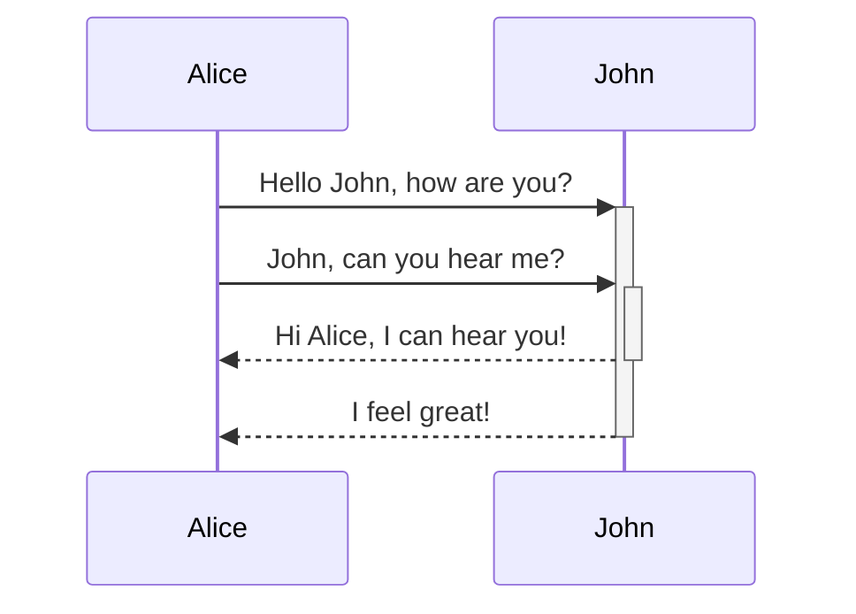
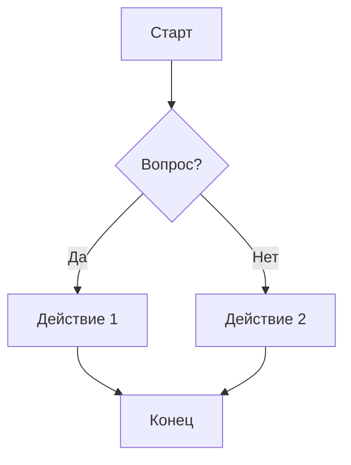
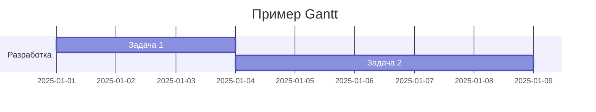

---
tags:
  - example
  - test
created: 2026-06-29T02:53:09
updated: 2026-06-29T03:22:29
---
> [!info]
> Этот файл рекомендуется использовать для тестирования тем Obsidian
# Header 1

Lorem ipsum dolor sit amet, consectetur adipiscing elit. Vestibulum scelerisque tincidunt lacus, vel dapibus lorem faucibus id. Nulla facilisi. Morbi tincidunt sapien nec erat consequat, ut cursus justo congue.

***Русский:***
Это пример текста с использованием различных стилей в Markdown. **Жирный текст** помогает выделить важные моменты, в то время как *курсив* используется для выделения менее значительных деталей или акцентов. ~~Зачеркнутый текст~~ может показать удаленные или неактуальные данные.

Выделение текста как ==хайлайт== помогает обратить внимание на ключевые фрагменты. ***Жирный курсив*** может использоваться для особо важного акцента. `Код` обычно выделяется с помощью моноширинного шрифта, что делает его легко различимым. Для добавления внешних ресурсов используем [ссылку](https://example.com) или ссылку как есть <https://example.com>. Хештеги, такие как #пример, часто используются для классификации или поиска контента. В математических текстах инлайн формула, например, $E = mc^2$, может быть использована для представления научных данных.

## Header 2 - **bold**, *italic*, ***bold-italic*******

Lorem ipsum dolor sit amet, consectetur adipiscing elit. Vestibulum scelerisque tincidunt lacus, vel dapibus lorem faucibus id. Nulla facilisi. Morbi tincidunt sapien nec erat consequat, ut cursus justo congue.

### Header 3

Lorem ipsum dolor sit amet, consectetur adipiscing elit. Vestibulum scelerisque tincidunt lacus, vel dapibus lorem faucibus id. Nulla facilisi. Morbi tincidunt sapien nec erat consequat, ut cursus justo congue.

#### Header 4

Lorem ipsum dolor sit amet, consectetur adipiscing elit. Vestibulum scelerisque tincidunt lacus, vel dapibus lorem faucibus id. Nulla facilisi. Morbi tincidunt sapien nec erat consequat, ut cursus justo congue.

##### Header 5

Lorem ipsum dolor sit amet, consectetur adipiscing elit. Vestibulum scelerisque tincidunt lacus, vel dapibus lorem faucibus id. Nulla facilisi. Morbi tincidunt sapien nec erat consequat, ut cursus justo congue.

###### Header 6

***Bold+Italic as tiny title***
Lorem ipsum dolor sit amet, consectetur adipiscing elit. Vestibulum scelerisque tincidunt lacus, vel dapibus lorem faucibus id. Nulla facilisi. Morbi tincidunt sapien nec erat consequat, ut cursus justo congue.

**Bold as tiny title**
Lorem ipsum dolor sit amet, consectetur adipiscing elit. Vestibulum scelerisque tincidunt lacus, vel dapibus lorem faucibus id. Nulla facilisi. Morbi tincidunt sapien nec erat consequat, ut cursus justo congue.

# Basic formatting syntax

Aliquam commodo, erat id rutrum interdum, dui ligula blandit massa, quis scelerisque magna quam at arcu. `Mauris pharetra` sit amet leo quis vestibulum. Morbi commodo, est non porta faucibus, justo nulla sagittis elit, vitae **ullamcorper** metus sem nec sem. Nam tempor, nunc non **consectetur** ornare, justo quam bibendum ex, id vestibulum velit felis vel ligula.

## Инлайн стили текста

- Базаовые стили
    - **Жирный текст**
    - *Курсивный текст*
    - ***Жирный и курсивный текст***
    - **Bold text and *nested italic* text**
    - *Italic text and **nested bold** text*
    - ~~Зачеркнутый текст~~
- Хитрое
    - ""Двойные кавычки"" - `"`
    - ''Двойные кавычки'' - `'`
    - \*\*This line will not be bold\*\*
    - \**This line will be italic and show the asterisks*\*
- Это комментарий %%комментария%% в тексте
- ==Выделение (highlight)==
- Какой-то `code ->!= <= =>` среди текста
- Формула $E = mc^2$
- Superscript: yyy<sup>text</sup> or $x^2$ (в Obsidian это может работать не во всех темах)
- Subscript: CO<sub>2</sub> or $x_1$ (также специфично для некоторых тем)
- <https://google.com>
- [Внешняя ссылка тегом](https://google.com)
- [Obsidian Note](obsidian://open?vault=MainVault&file=Note.md)
- #hashtag
- Ссылка на внутренний документ [README](</README.md>)
- Footnotes

```
    - This is a simple footnote.[^1]
```

    - This is a simple footnote.[^2]

## Спойлеры (плагин `blindfold`)

```blindfold
Какой-то скрытый текст по умолчанию, чтобы не занимал место.

- Список
- Список
- Список
```

## Картинки + Embedings

1. You can add images with external URLs, by adding a `!` symbol before an [external link](https://help.obsidian.md/Editing+and+formatting/Basic+formatting+syntax#External%20links).


2. You can change the image dimensions, by adding `|640x480` or `|100` to the link destination, where 640 is the width and 480 is the height.
3. YouTube video

```

```

## Quotes, цитаты

Простая:

> Human beings face ever more complex and urgent problems, and their effectiveness in dealing with these problems is a matter that is critical to the stability and continued progress of society.

Сложная:

> [!quote]
> *Human beings face ever more complex and urgent problems, and their effectiveness in dealing with these problems is a matter that is critical to the stability and continued progress of society.*
> - Doug Engelbart, 1961

## Списки

### Lists

1. Первый элемент нумерованного списка
2. Второй элемент нумерованного списка
3. Вложенный элемент

### Task List

#### Базовые возможности

- [ ] Задача не выполнена
    - [ ] Вложенная подзадача 1
    - [x] Вложенная подзадача 2
- [x] Задача выполнена
    - [x] Вложенная подзадача 1
    - [ ] Вложенная подзадача 2
    - [x] Вложенная подзадача 3
    - [x] Вложенная подзадача 4
    - [x] Вложенная подзадача 5
- [ ] Следующая задача
    - [ ] Вложенная подзадача
    - [x] Вложенная подзадача 2
    - [ ] Вложенная подзадача 3

#### Basic checklists

- [ ] normal
- [/] / - incomplete
- [x] x - done
- [-] - canceled
- [s] s - forwarded
- [<] < - scheduling

#### Extras checklists *(optional)*

- [?] ? - question
- [!] ! - exclamation
- [*] * - star
- ["] " - quote
- [l] l - location
- [b] b - bookmark
- [i] i - information
- [S] S - savings
- [I] I - idea
- [p] p - thumbs up
- [c] c - thumbs down
- [f] f - fire
- [k] k - key
- [w] w - win
- [u] u - up
- [d] d - down

### Nesting lists

1. First list item
2. Second sub item
3. Ordered nested list item
4. Second list item

- Unordered nested list item
- Another one

## Пример кода (Python)

Text inside `backticks` on a line will be formatted like code.

```python
def fibonacci(n):
    """Return the n-th Fibonacci number."""
    if n <= 1:
        return n
    return fibonacci(n - 1) + fibonacci(n - 2)


print(fibonacci(10))
```

## Comments

You can add comments by wrapping text with `%%`. Comments are only visible in Editing view.

This is an %%inline%% comment.

%% This is a block comment.

Block comments can span multiple lines. %%

---

# Advanced formatting syntax

## Simple table

| ID | Название | Описание                  | Количество | Цена  |
|----|----------|---------------------------|-----------:|-------|
| 1  | Товар A  | Краткое описание товара A |         10 | 15.50 |
| 2  | Товар B  | Краткое описание товара B |          5 | 25.00 |
| 3  | Товар C  | Краткое описание товара C |       2000 | 5.75  |
| 4  | Товар D  | Краткое описание товара D |          7 | 12.30 |
| 5  | Товар E  | Краткое описание товара E |          3 | 50.00 |

## Vertical bars in tables

| First column | Second column |
|--------------|---------------|
| **Bold**     | Text          |

Align text in columns by adding colons (`:`) to the header row. You can also align content in *Live Preview* via the context menu.

 Left-aligned text | Center-aligned text | Right-aligned text
:------------------|:-------------------:|-------------------:
 Content           |       Content       |            Content

## Diagrams (Mermaid JS)

### Sequence



### Flowchart



### Gantt Chart



## Формулы

### Пример inline формулы

Эйнштейновская формула: $E = mc^2$, где $E$ - энергия, $m$ - масса, $c$ - скорость света.

### Пример многострочной формулы

Базовая формула интеграла:
$$
\int_a^b f(x) \, dx = F(b) - F(a)
$$
где:

- $F(x)$ - первообразная функции $f(x)$.
- $a$ и $b$ - пределы интегрирования.

## Callouts

> [!info]
> Here's a callout block.
> It supports **Markdown**, [Wikilinks](</README.md>), and [embeds](</CLAUDE.md>)!
> 

> [!tip] Callouts can have custom titles
> Like this one.

> [!tip] Title-only callout

> [!faq]- Are callouts foldable?
> Yes! In a foldable callout, the contents are hidden when the callout is collapsed.

> [!question] Can callouts be nested?
>
> > [!todo] Yes!, they can.
> >
> > > [!example] You can even use multiple layers of nesting.

### Customizations

> [!abstract]
> Aliases: `abstract`, `summary`, `tldr`

> [!info]
> Text

> [!todo]
> Text

> [!tip]
> Aliases: `tip`, `hint`, `important`

> [!success]
> Aliases: `success`, `check`, `done`

> [!question]
> Aliases: `question`, `help`, `faq`

> [!warning]
> Aliases: `warning`, `caution`, `attention`

> [!failure]
> Aliases: `failure`, `fail`, `missing`

> [!danger]
> Aliases: `danger`, `error`

> [!bug]
> Text

> [!example]
> Text

> [!quote]
> Aliases: `quote`, `cite`

## ***Footnotes***

[^1]: This is the referenced text.
[^2]: Add 2 spaces at the start of each new line. This lets you write footnotes that span multiple lines.
